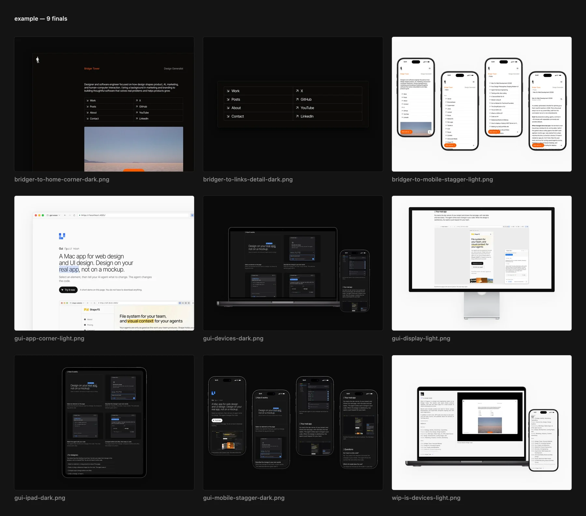

# pshot

Product shots of your work, made by your AI agent. [pshot.dev](https://pshot.dev)

[](site/assets/contact-sheet.png)

pshot captures websites, local dev servers, Figma frames, and Mac/iOS apps, then composes them into
high-resolution product shots and short scroll videos. It's opinionated on purpose: near-black and
off-white canvases, 4:3 at 3200×2400, every shot in both dark and light, minimal framing or real Apple
device frames, and never an upscaled pixel. It's built to be driven by an AI agent (it ships a Claude Code
skill), and works just as well by hand.

## Install

```sh
curl -fsSL https://pshot.dev/install | bash
```

This installs Bun and ffmpeg if needed, clones pshot to `~/Projects/pshot` (set `PSHOT_DIR` to change
that), installs Chromium, downloads Apple's product bezels from Apple's Design Resources, links the global
`pshot` command, and installs the Claude Code skill. Downloading the bezels accepts Apple's bezel license;
set `PSHOT_SKIP_BEZELS=1` to skip it and use CSS frames instead. Re-run the same command to update.

**Requirements.** macOS. Websites and Figma work out of the box. Mac app capture needs Screen Recording
permission for your terminal and the Xcode Command Line Tools (`xcode-select --install`). iOS capture needs
Xcode with a Simulator. Figma exports need a `FIGMA_TOKEN` in `~/Projects/pshot/.env`.

## Use it with your agent

With the skill installed, ask Claude Code from any project:

> take product shots of https://your-site.com

The agent scouts the site, writes a recipe, renders every shot in dark and light, reviews the results, and
shows you a contact sheet before delivering anything.

## Use it by hand

```sh
cd your-project
pshot init https://your-site.com   # writes ./shots.yaml
pshot                              # renders every shot, dark + light
pshot --shot home --reuse          # iterate on one shot without recapturing
pshot --out public/work            # also copy the finals into this project
```

Finals and a contact sheet are written to pshot's own folder, `~/Projects/pshot/output/<project>/`.
`--out` copies them into your project as well.

A recipe is a list of shots. Each one has a source and a layout:

```yaml
project: my-site
defaults:
  web: { url: https://my-site.com, viewport: 1280x800 }

shots:
  # The page, unframed.
  - id: home
    source: { type: web }
    layout: single

  # Big UI running off the right and bottom edges.
  - id: close-up
    source: { type: web }
    layout: bleed
    options: { edge: corner, zoom: 1.4 }

  # MacBook + iPhone, a different page on each.
  - id: devices
    sources:
      - { type: web, frame: macbook }
      - { type: web, url: https://my-site.com/work, frame: iphone }
    layout: duo

  # A Figma frame, exported at 4×.
  - id: figma
    source: { type: figma, url: "https://figma.com/design/FILE/NAME?node-id=1-2" }
    layout: single

  # The booted iOS Simulator, with a clean 9:41 status bar.
  - id: ios
    source: { type: ios, url: https://my-site.com, frame: iphone }
    layout: single

  # A smooth 60fps scroll video.
  - id: scroll
    source: { type: web, frame: iphone }
    layout: single
    motion: { kind: scroll, duration: 5, to: "#work" }
```

**Layouts:** `single`, `detail`, `bleed`, `duo`, `row`, `grid`, `stagger`.
**Frames:** `iphone`, `ipad`, `macbook`, `display`.

Device screens are always filled exactly, and nothing is ever upscaled: web captures re-render at the
density each layout needs, and QA flags anything that would be soft or cropped.

Every option is in [docs/recipes.md](docs/recipes.md).

## License

MIT. Apple's product bezels are not included in this repository. They are downloaded from Apple and are
subject to Apple's terms.
